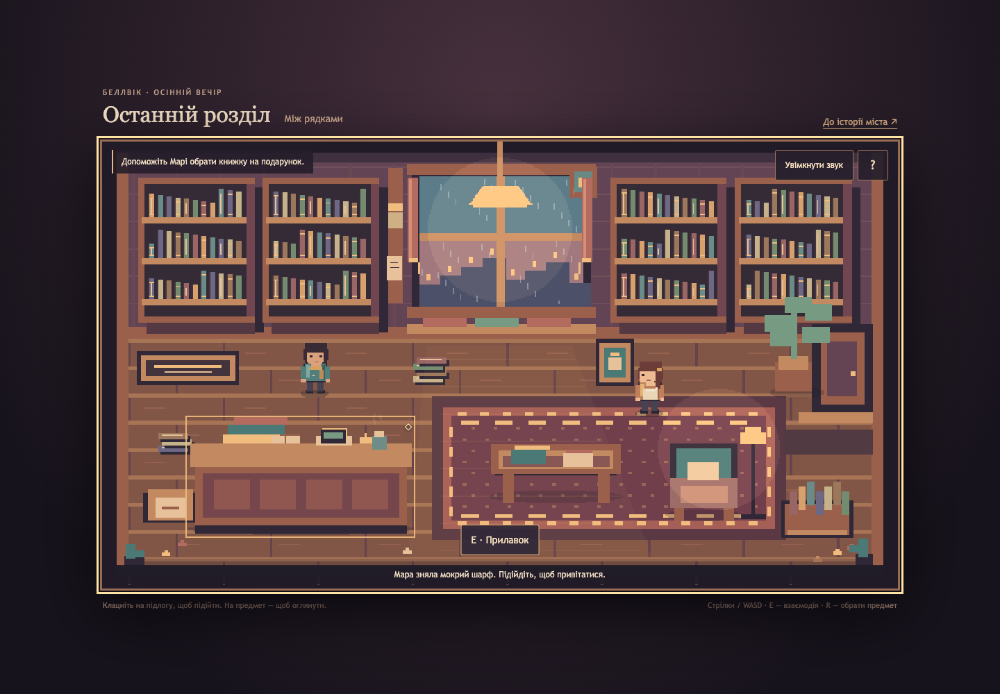
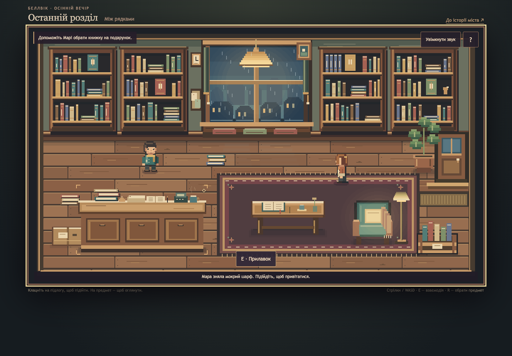
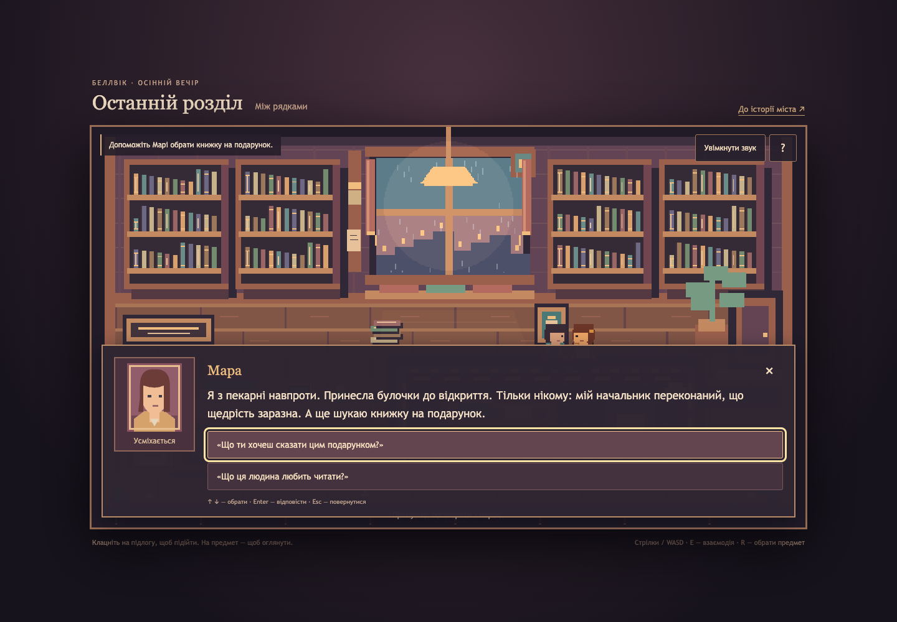
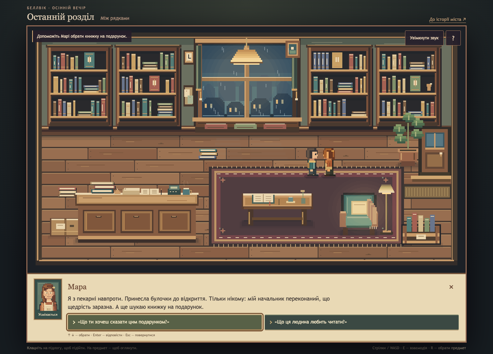
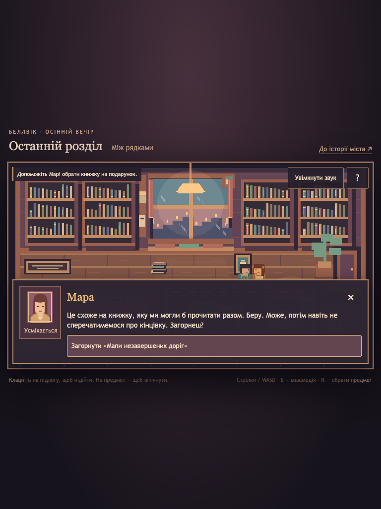
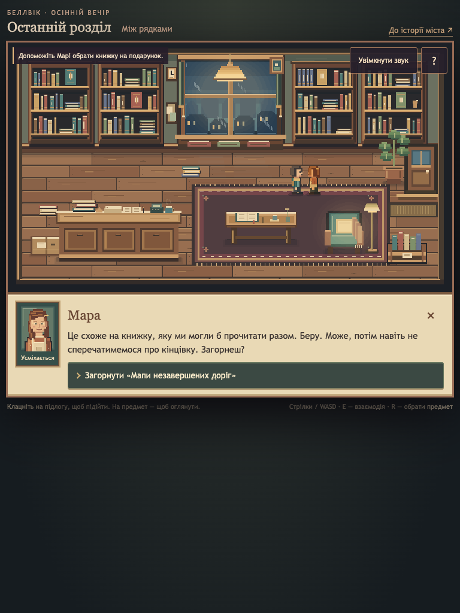

# Cozy bookshop — art pass V4

Review record: 2026-10-25.

Related: [art issue #4](https://github.com/vlovers/last-chapter/issues/4).
Run `npm ci`, `npm run dev`, then open `http://localhost:5173/phaser-prototype/`.
Controls and short encounter are unchanged: arrows/WASD, click/tap to move or select,
E to interact, R/Enter to choose objects, and `?` for help/audio/reduced motion.

## Before / after

Both versions were captured in actual Chrome at identical viewports. Full-page
screenshots include the dialogue dock's extra document height where needed. The
baseline is synchronized commit `e81fa58`, containing `80903cd`, `06b11e0`, `f807b8c`
and the remote art documents/rain source. The newer remote legacy dialogue renderer
was reconciled in favor of the required working slice; all remote history is retained.

| View                     | Before                                              | V4                                             |
| ------------------------ | --------------------------------------------------- | ---------------------------------------------- |
| Desktop room · 1440×1000 |    |    |
| Conversation · 1440×1000 |  |  |
| Tablet · 768×1024        |      |      |

## Art changes

- **Composition:** removed vertical page centering and tightened the header/footer.
  At the desktop capture size the room grows from approximately 1146×645 to 1280×720,
  giving exact 2× native pixels. Tablet fits uniformly with nearest-neighbor rendering;
  its fractional fit is intentional, not a stretched aspect ratio. No smoothing filter.
- **Room:** olive plaster and walnut joinery replace the flat rose/brown palette.
  Four hand-arranged collections mix varied spines, folios, face-out covers, gaps and
  a brass bookend. Individual plank joints/grain, bevelled counter panels, an order
  ledger/register, paper roll, cup/bell, parcel, pinned notices and clock add character.
  The reading area has a worn woven rug, open book/bookmark, pencil, saucer, dried flower,
  upholstered chair and knitted throw. Raised props remain on existing furniture.
- **Depth and light:** layered foot-contact shadows, bevels, inset cabinets, architectural
  foreground, cold rooftop layers and reflected glass light. Warm pendant/reading pools
  use a few local translucent ellipses; no full-screen postprocessing or new shader.
  Existing rain skips mullions; reduced motion freezes weather, light and actor animation.
- **People:** original stepped silhouettes, profile noses, front/back costume details,
  hair highlights, Mara's gold clip/flour-marked apron and the player's teal coat/scarf.
  All four directions retain two idle and four walk frames at 32×48. The idle blink is
  brief with a longer resting pose. Three new 64×80 expressions match Mara's sprite.
- **Dialogue:** parchment dock below the room, smaller portrait, clearer name/text hierarchy,
  paired desktop choices, stacked tablet choices, contrast/focus markers and bounded
  vertical scrolling for long copy. It covers **zero canvas pixels**. Object descriptions
  use a compact note without a fake character portrait. Keyboard names remain unchanged;
  the decorative choice chevron is drawn with CSS borders, not announced as text.

All artwork is original project work. No external packs were imported or licenses
purchased/claimed. [Attribution and editable sources](../../../public/art/bookshop/ATTRIBUTION.md)
and the runtime manifest in `assets.js` record the new sources and dimensions.
The synchronized `rain-window.svg` remains an unused art source; active weather uses
the existing deterministic procedural layer, preserving its tested reduced-motion behavior.

## Verification

The original movement/collision geometry, story content/state, endings, audio logic,
save format and production `src/` files have no V4 changes. No npm dependencies were added.

- `npm run format:check`, `npm run lint`, `npm run typecheck`, `npm test`, `npm run build`:
  passed; **36 files / 142 tests**. Vite's existing isolated Phaser chunk-size warning remains.
- Three new art regressions check native-grid paint bounds (including edge grain),
  distinct local portrait sources/manifest geometry, and motion-free rain confined to glass.
- Chrome desktop/tablet browser suite passes all pre-existing scenarios and V4 checks:
  furniture collision and routing, four objects, directional walk frames, both gift endings,
  close/resume, held-key guard, portrait mood changes, audio controls, reduced motion,
  exact canvas aspect/native size, nearest-neighbor CSS, resized hit-area alignment,
  actual tablet tap, dock non-occlusion, wrapping, missing portraits/audio, initialization
  failure and byte-identical production saves. Captures were visually inspected.
- The same expanded suite passed against the production build at
  `http://127.0.0.1:4174`. Normal desktop/tablet play had no console/page errors;
  intentionally blocked resources showed the expected fallback/recovery UI.
  Production-run evidence is saved as `qa-build.json` alongside this report.

Reproduce with the optional Playwright setup in [Testing](../../TESTING.md), using
`QA_OUTPUT=/private/tmp/last-chapter-v4-after`. Baseline and final screenshots are committed
above; machine-local results also live under `/private/tmp/last-chapter-v4-before` and
`/private/tmp/last-chapter-v4-after`. The runner bounds cleanup of its own Chrome fixture.

Unverified: physical tablets/retina screens, Safari/Firefox, a full screen-reader/contrast
instrument audit, subjective audio mixing and human Ukrainian/art editorial review.
The standalone Chrome runner was used because the in-app browser bridge was unavailable.
The encounter remains temporary-state and isolated; this is not a full episode or an
approved production narrative bridge.
