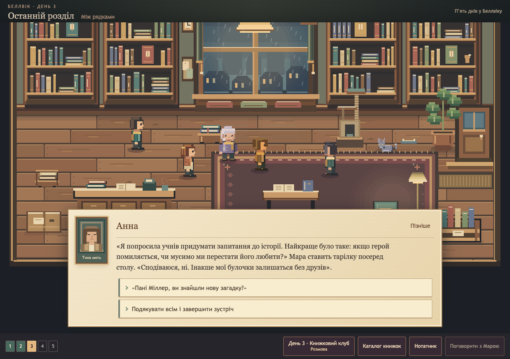
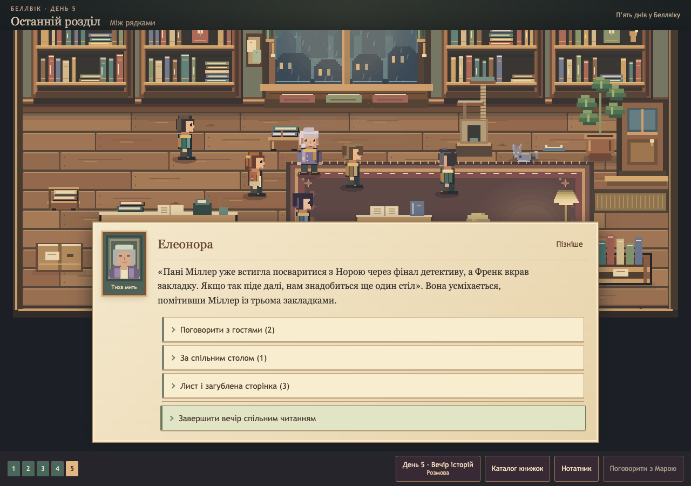
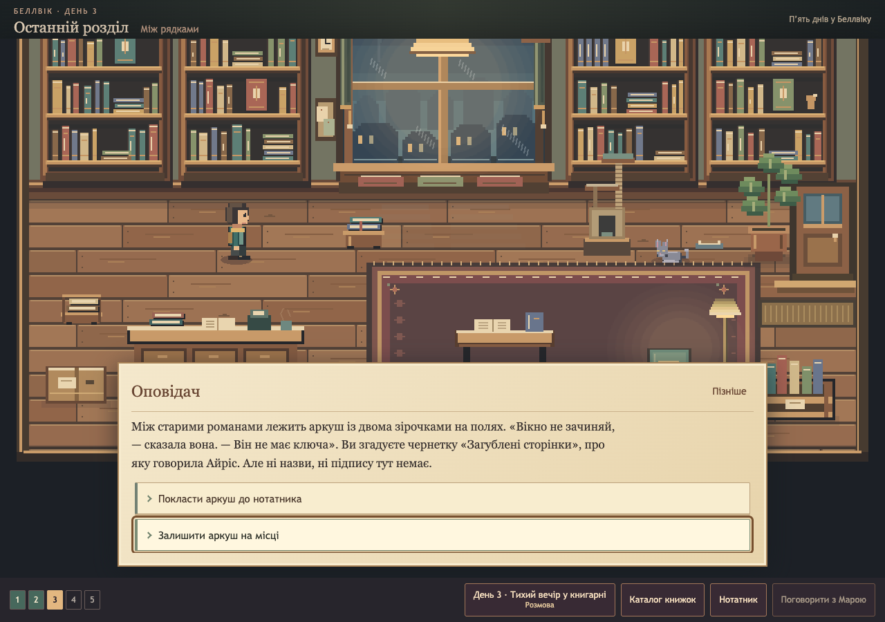
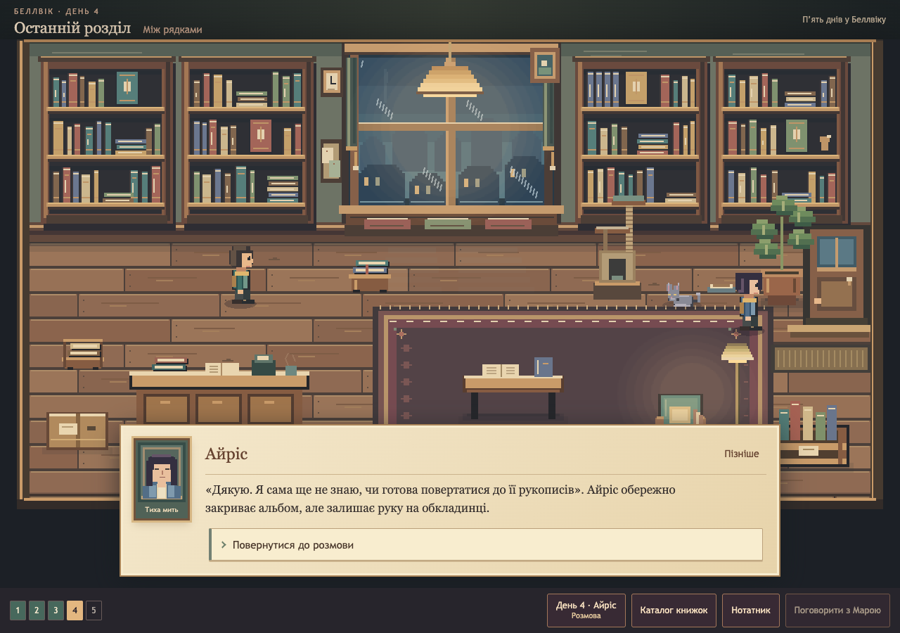
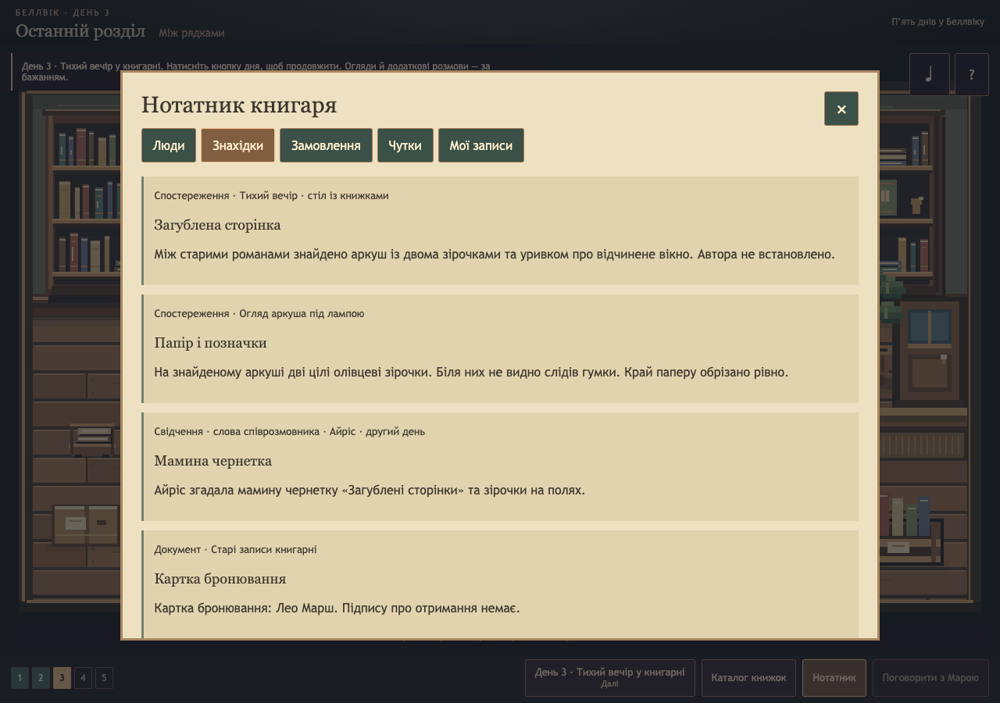
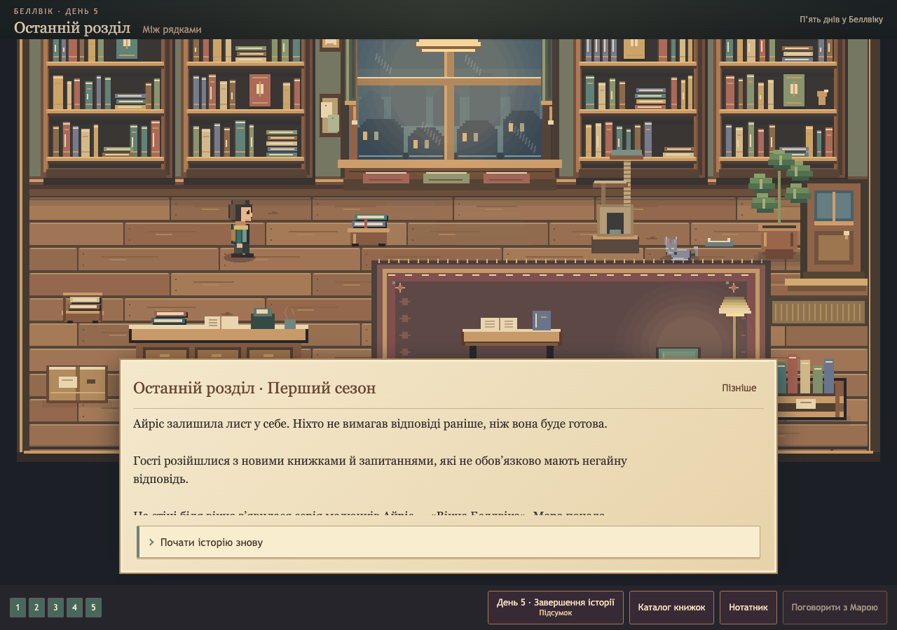
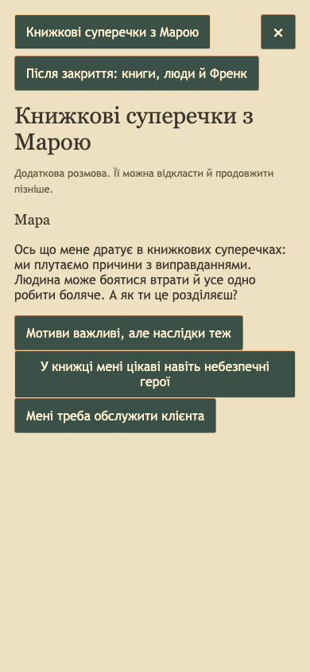
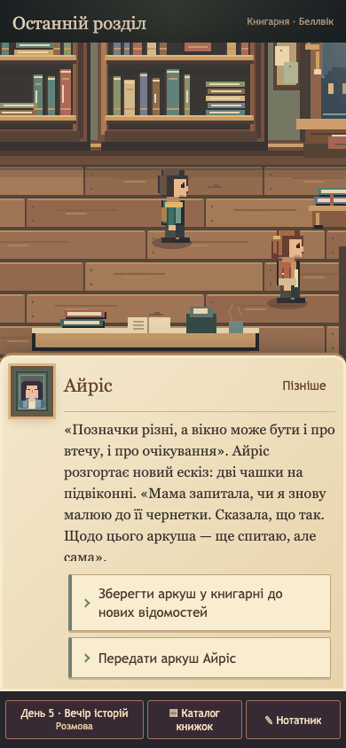
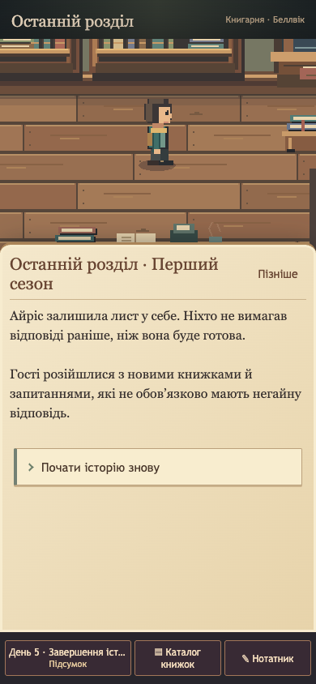

# Five-day production and playtest candidate — 2026-10-28

## Scope and synchronization

The initial checkout was behind the narrative branch and contained an uncommitted
test edit. Work stayed in a dedicated worktree and branch,
`feat/five-day-production-quality-20261028`; the original checkout was preserved.
`main` was still the repository bootstrap. Open PRs and active branches were
reviewed before editing. The batch incorporates the narrative work through
`519348c`, including character-specific Day 4 follow-ups and the latest grounded
Day 5 prose. No PR was merged, and nothing was deployed or published as a game.

## Already implemented

- The deterministic five-day chapter graph, eight principal characters, letter and rumor arcs, composable endings and v1 saves.
- Both Day 3 routes and initial Day 4/5 manuscript decisions on the latest narrative branch.
- Five catalog books, three customer orders, optional Mara sessions, exploration, journal, original Phaser room and interactive Frank.
- Mobile layout, keyboard controls, collision/pathfinding, visitor lifecycle, original character art and extensive regression fixtures.

## Broken or incomplete behavior fixed

- The v5 browser runner used a Node assertion in browser scope and failed before completing its season walk. Its previous internal-API walk did not prove UI progression.
- The quiet-evening stage was absent from the journal's encounter ordering, making all previously met people disappear for that route.
- Manuscript discovery, inspected markings, postcard comparison, interpretation and custody were missing from journal evidence.
- Optional sessions and notes could survive a missing/invalid main save and contaminate a new playthrough. Fresh playthroughs also lacked an initial save to anchor early notes.
- The Day 3 checkpoint did not identify which evening actually happened.
- Finale pagination needed meaningful categories and an always-visible finish action. Presentation navigation is now separate from canonical dialogue availability.
- The club and final gathering described guests while the room showed none. Four club guests and eight finale guests now reuse existing cast art, with deterministic placement, reduced-motion support and owned-object cleanup.
- Long dialogue text now starts at its top on each new node. Journal focus cycling excludes disabled/hidden controls, and investigation actions name the actual clue.
- Stale prose assertions and old Day 4 routes were reconciled with reviewed incoming dialogue changes; no checks were skipped or disabled.

## Narrative and gameplay improvements

Iris introduces her mother's draft, «Загублені сторінки», during Day 2's art
conversation. The quiet evening contains an actual excerpt, two pencil stars,
paper inspection and an optional moment with Frank. Players can compare both
the physical marks and the window interpretation before making an agreement
with Iris. Observations, testimony, interpretation and custody use separate flags.

The ending resolves what happens to the page without claiming its author has
been proven. Returning it and archiving it remain mutually exclusive. Iris's
postcard and the excerpt support different readings; choosing one does not
rewrite objective facts. Her renewed drawing and conversation with her mother
give the discovery a personal consequence. Club dialogue has more concrete
disagreement, food, awkwardness and humor. Ukrainian gender and vocative errors
were corrected in touched scenes.

The finale offers four groups with available conversation counts. All authored
options retain their IDs, prerequisites, grants and completion semantics. The
finish action remains outside the optional-topic scroller. Pagination and group
navigation never write a narrative save or consume a topic. Unit tests compare
the complete reachable UI menu with the canonical choice set for fresh,
partially completed and clue-rich saves.

## Complete real-UI route verification

All four routes ran from a fresh browser context to `season-complete`, checked
five completed timeline days, saved their actual ending, reloaded, verified three
receipts and restarted without carrying decisions or optional memories forward.
Narrative transitions were button clicks, not injected saves or internal API calls.

| Route | Actual coverage                                                                                                                                | Story/control choices | Full reloads | Result |
| ----- | ---------------------------------------------------------------------------------------------------------------------------------------------- | --------------------: | -----------: | ------ |
| A     | Standard progression; three catalog orders; all character encounters; book club; private mutual letter conversation; exhibition; final reading |                   112 |            1 | Passed |
| B     | Skip club; inspect page; compare stars; respect Iris's privacy; return page; correct independent ending                                        |                   118 |            1 | Passed |
| C     | Alternative books; skip club; window interpretation; limited inquiry; archive page; alternative ending                                         |                   118 |            1 | Passed |
| D     | 390×844 phone; both clues; conversation/checkpoint/custody reloads; unfinished optional Mara session resumed on Day 4                          |                   120 |           10 | Passed |

Each route visited 19 stages. Both evenings were exercised across the four runs;
the manuscript did not leak into Route A's ending. Browser error arrays were empty.
The route counts exclude catalog and presentation-only navigation clicks.
Raw route results are in [routes.json](routes.json).

## Additional verification

- `npm ci`: passed using Node 22 and the committed lockfile; no dependency changes were needed.
- `npm run check`: passed — formatting, ESLint, TypeScript, **795 tests in 138 files**, and production build.
- `npm run test:browser:v5`: passed all four routes above, including real guest visibility and the pinned finish control.
- `npm run test:browser:mobile`: passed six layouts (375, 390, 430, 768, 1440 and phone landscape), touch/keyboard movement, catalog orders, day transitions and finale reload. See [mobile.json](mobile.json).
- Storage recovery: missing/corrupt main saves clear orphan notes, sessions and receipts; blocked storage leaves dialogue playable and shows the save warning. Journal keyboard focus checks passed. See [recovery.json](recovery.json).
- `npm audit --audit-level=high`: passed, zero vulnerabilities.
- Existing movement, gameplay polish, stabilization and Frank suites: final repeat recorded in [browser-suites.json](browser-suites.json).
- Production-preview coverage is recorded in [production-preview.json](production-preview.json).

Chrome ran through the repository's Playwright fixture. Screenshots and traces
were collected under `/private/tmp/last-chapter-production-qa`; selected screenshots
and compact results are committed here. Large trace ZIPs stay out of Git.
CI now separates runner outputs and uploads browser evidence for seven days,
including failed runs. The isolated `/phaser-prototype/` keeps its save boundary.

## Representative screenshots

## Remaining limits and readiness

There are no known progression blockers on the tested routes. This is ready for
a structured external playtest of the short five-day game once the PR is reviewed.
It is not a measured or finished 40-minute episode.

- **Implemented and tested:** five-day progression, both evenings, manuscript custody, normal save/reload, recovery, three orders, restart, grouped finale and guest lifecycle.
- **Partially tested:** the full combination space of optional narrative decisions; Ukrainian editing beyond reviewed scenes; accessibility beyond automated keyboard/layout checks; device performance beyond the tested Chrome environment.
- **Not established:** an independent native Ukrainian editorial review, measured pacing/runtime, real iOS/Safari/Firefox playthroughs or an audio listening review. Longer planned content and additional proposed characters are not part of this batch.
- **Known technical limit:** Vite still reports the existing large Phaser bundle warning (about 1.57 MB minified / 423 kB gzip). The gate passes; slow-device and startup assessment remains useful for playtesting.

Suggested playtest questions: where players first form a manuscript theory,
whether they notice both clues and the notebook categories, whether Iris's
ending feels earned, which conversations they voluntarily skip, and how long
the full five days actually take. Gathering guests are cosmetic staging; story
conversations remain available through the day control and finale topic menu.
