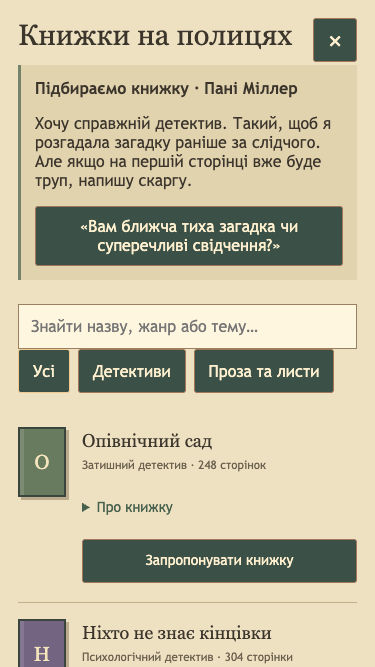
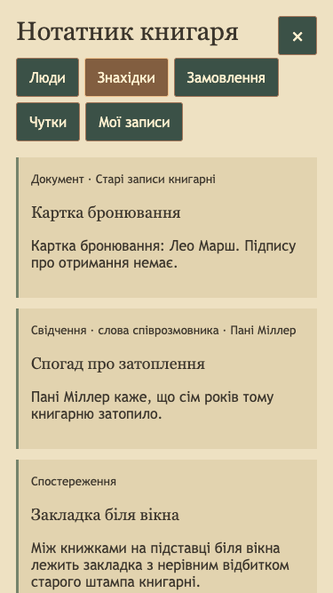
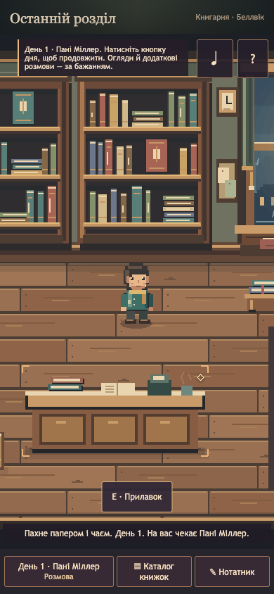

# Stabilization and narrative readiness — 2026-10-26

Scope: existing [PR #23](https://github.com/vlovers/last-chapter/pull/23), based on
`feat/gameplay-visual-polish-v1`. No PR was merged, retargeted, duplicated or force-pushed.
The narrative design branch was inspected separately; its proposed story was not imported.
This remains a short five-day prototype, not a verified finished forty-minute episode.

## CI failures: evidence and repairs

1. [Original Browser QA run](https://github.com/vlovers/last-chapter/actions/runs/40382641834)
   failed in `qa-polish-v1.mjs`: Frank had not moved more than ten world pixels after
   8.4 wall seconds. At five FPS the collision-safe 50 ms timestep advances only
   2.1 simulated seconds, below his initial 4.5-second idle. A deterministic test
   reproduces this. The runner now observes seven simulated seconds, retaining the
   movement/collision/pause assertions and a 45-second wall watchdog.
2. [Intermediate CI run](https://github.com/vlovers/last-chapter/actions/runs/40387460260)
   exposed slow visitor arrival in the isolated slice. Hundreds of static native
   paint primitives were redrawn every frame. The immutable room, tight furniture
   bounds and light pools are now cached in native pixel textures. Original depth,
   collision geometry and integer pixel coordinates remain; ambient alpha still animates.
   Tests retain authored paint-bound checks and impose a native texture-area budget.
3. [Next CI run](https://github.com/vlovers/last-chapter/actions/runs/40389197522)
   passed the legacy, V5 and mobile routes, then failed the cat-tree wait: at 6.41 FPS
   Frank was still climbing, elevation **81.4/85**. The cat runner now waits against
   simulated time with a 90-second wall watchdog. It still requires actual `resting`
   state, full elevation 85, valid collision position and saved interaction counts.
   A unit fixture starts at the actual food-bowl location and reproduces the race.
4. Some local Chrome transports never settle `close()` or even `kill()`, after
   successful assertions. All QA CLIs now own bounded browser-server cleanup.
   Child-process tests deliberately hang both calls and verify success exits zero
   while an original assertion still exits one with its original error. No test
   failure is swallowed by cleanup.

These were reproducible timing/rendering/runner defects, not evidence that GitHub
infrastructure alone was broken. No check was disabled and no behavioral assertion
was removed to obtain a green result. The successful intermediate standalone
[Browser QA run](https://github.com/vlovers/last-chapter/actions/runs/40389207584)
also exercises the new stabilization audit. Consult the PR's checks for final-head CI;
historical failures remain visible rather than being erased by a force-push.

## Player UX audit and implemented changes

| Player concern             | Observed issue / verified behavior                                      | Result                                                                                                                                                 |
| -------------------------- | ----------------------------------------------------------------------- | ------------------------------------------------------------------------------------------------------------------------------------------------------ |
| Where to go next           | A day label did not distinguish speaking, choosing a book and advancing | Main action now has a visible next-action line, accessible label and concise Ukrainian guidance                                                        |
| Recognizing a request      | Catalog advice did not include the actual request                       | The original authored customer prompt appears above the optional question and recommendation actions                                                   |
| Recommending a book        | Closing the dialogue could make the next step unclear                   | At an active request, the main action opens the catalog directly; selection resumes the original graph                                                 |
| Unsuitable books / retries | Reaction vanished after reopening/reload                                | Last reaction persists; refusals keep the order open; accepted choices preserve their original receipt and cannot sell twice                           |
| Required versus optional   | Social invitations could summon Mara while absent                       | Invitations say they are optional and require her actual visit; unknown Mara is hidden and absent known Mara has an explanation                        |
| Long conversations         | A tiny close glyph did not explain deferral                             | Visible **Пізніше** preserves the current node; Escape/reload resume without inventing decisions. It does not auto-complete required choices           |
| Screen load                | Existing mobile HUD and full-screen catalog/journal are retained        | No horizontal overflow at six sizes; overlays preserve canvas bounds/zoom and block click-through                                                      |
| Reading and keyboard       | Long content needs local scrolling and usable focus                     | A four-thousand-character renderer fixture scrolls inside the panel; focus remains reachable and reduced motion creates no typing timers               |
| Notebook facts             | Existing documents/testimony were less visible than optional hints      | Discovered reservation/repair records and testimony are projected explicitly; timeline deduction is labelled an assumption, never verified observation |
| Quiet moments              | Existing ambience and everyday actions are present                      | Rain/light/dust, browsing/page turns, chair, autonomous cat and food/play/tree remain optional; no extra mandatory mystery or random event was added   |
| Physical reactions         | Existing reusable visitor and counter/book reactions remain functional  | Arrival/departure, facing/gestures, book handoff and catalog feedback checked through the full route                                                   |

Closing a required conversation is deferral, not a fast-forward that chooses on the
player's behalf. Existing optional short exits remain. An authored short route for
each future deep scene is an integration acceptance criterion, not a shipped claim.

## Executed validation

Local environment: Node **22.12.0**, macOS headless Chrome using optional Playwright.
Tests used a frozen source copy on port 5176 to prevent edits/HMR from invalidating
in-progress route tests. The in-app browser bridge was unavailable; Playwright was
the fallback. No optional browser package was added to production dependencies.

| Check                            | Result and practical coverage                                                                                                                                                                              |
| -------------------------------- | ---------------------------------------------------------------------------------------------------------------------------------------------------------------------------------------------------------- |
| `npm run check`                  | Passed: Prettier, ESLint, TypeScript, **582 tests / 113 files**, production build                                                                                                                          |
| `npm audit --audit-level=high`   | Passed, zero reported vulnerabilities                                                                                                                                                                      |
| `test:browser`                   | Passed: isolated slice branches, movement/collision, settings/audio state, confidentiality, both gift endings, fallback and save isolation                                                                 |
| `test:browser:v5`                | Passed: canonical story, clue board, diary/counter, five-day route and no browser errors                                                                                                                   |
| `test:browser:polish`            | Passed: all **19 checkpoints** at desktop, compact desktop, tablet and phone; optional completion/resume/restart; ambient movement and layout                                                              |
| `test:browser:mobile`            | Passed: **375×667, 390×844, 430×932, 768×1024, 1440×900, 844×390**, touch and keyboard, live orientation change, search/privacy/focus, three saved purchases and all checkpoints                           |
| `test:browser:stabilization`     | Passed: first-use suspension/reload, all **15 customer/book pairs**, optional question variants, rejected/accepted reactions after reopening/reload, no duplicate receipt, actual journal provenance       |
| `qa-frank-overhaul.mjs`          | Passed: pet cooldown, feeding/eating, play, full tree climb/rest, saved counts, collision validity, reading chair and no browser errors                                                                    |
| Unit order matrix                | **30 cases**: each real catalog book × all three customers × with/without clarification, retry/suspend/reload/idempotence; old receipt without sidecar blocks a duplicate sale                             |
| Large-save / bounded diagnostics | 600 flags, 5,000 history entries and 2,000 completion records load; history compaction preserves authoritative completion; invalid/oversized data remains rejected; 150 declined attempts stay bounded     |
| Soak / cleanup                   | **120 overlay cycles**, window listeners **20→20**, document listeners **17→17**, scene objects **31→31**, followed by 30 seconds idle; separate **30 simulated minutes** of collision-safe Frank behavior |

The browser matrix uses valid mid-request save fixtures to reach each book branch;
first-use and full five-day suites exercise genuine UI progression. The long-text
fixture is an explicit renderer stress input, not newly shipped dialogue. Counts
above describe the executed tests rather than hours of physical-device play.

### Complete existing recommendation outcomes

No invented books or changed canon were introduced. Refusals retain the open
request; accepted choices use the existing narrative option and receipt.

| Actual catalog ID | Miller | Mara   | Anna   |
| ----------------- | ------ | ------ | ------ |
| `orchard`         | Accept | Open   | Open   |
| `witnesses`       | Accept | Open   | Accept |
| `station`         | Open   | Accept | Open   |
| `roads`           | Open   | Accept | Accept |
| `letters`         | Open   | Accept | Open   |

Every pair is checked in browser; both question choices are covered deterministically.
Accepted outcomes retain distinct authored reactions. Recommending again after a
reload cannot grant another receipt/event. Refusal followed by an accepted retry
is covered. Required day progression does not inspect whether the optional question
or Frank interactions were completed.

### Performance evidence and limits

The native paint cache removes repeated static vector drawing without adding
large imported art. Scene objects remain constant at 31. Initial local concurrent
measurements recorded **31–46 FPS**, medians around **35 FPS**, at normal and 4×
CPU throttling; the effect budget reduced decoration automatically. A later
stabilization soak ended around **60.5 FPS**. These are headless desktop observations,
not a guaranteed phone FPS target. The raw samples are included below.

The production bundle remains about 1.52 MB minified / 410 KB gzip and Vite reports
the existing large-chunk warning. This stage did not conceal it or claim universal
60 FPS. Tab visibility, reduced motion, disposal and reusable objects remain
covered by existing and new regression checks.

Still unverified: physical iOS Safari/Android devices, thermal/battery behavior,
screen-reader listening with VoiceOver/TalkBack, subjective audio balance, and
multi-hour real-time play. Keyboard semantics/focus tests are not a full WCAG audit.

## Evidence files and remaining integration blockers

- [Stabilization browser results](stabilization-results.json)
- [Five-day polish results](polish-results.json)
- [Mobile results](mobile-results.json)
- [Frank results](frank-results.json)
- [V5 results](v5-results.json)
- [Performance samples](performance.json)
- [Technical integration plan and actual-versus-proposed inventory](../../integration/NARRATIVE-READINESS.md)

Concrete content blockers: incompatible proposed order outcomes and nonexistent
catalog SKUs; unapproved archive/manuscript canon and access/biography; a source
branch TypeScript error and invalid dialogue terminals; five merge conflicts;
missing Oliver/Sophie actor/presence integration; no independent session registry
for the proposed long scenes. Parent PR #18 also has failed checks and needs its
own narrow repairs before a human-approved bottom-up merge. These are not resolved
by marking PR #23 green.

